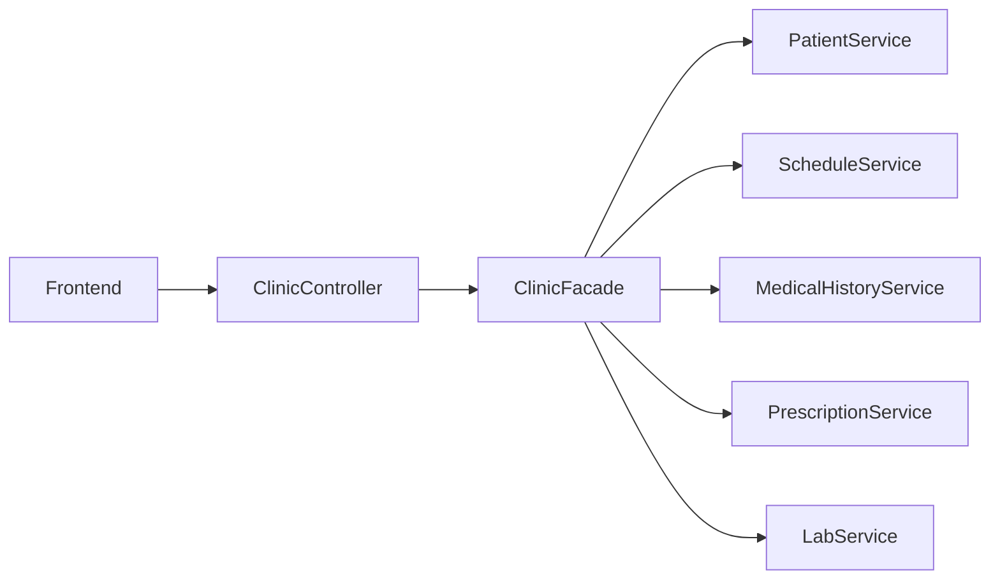
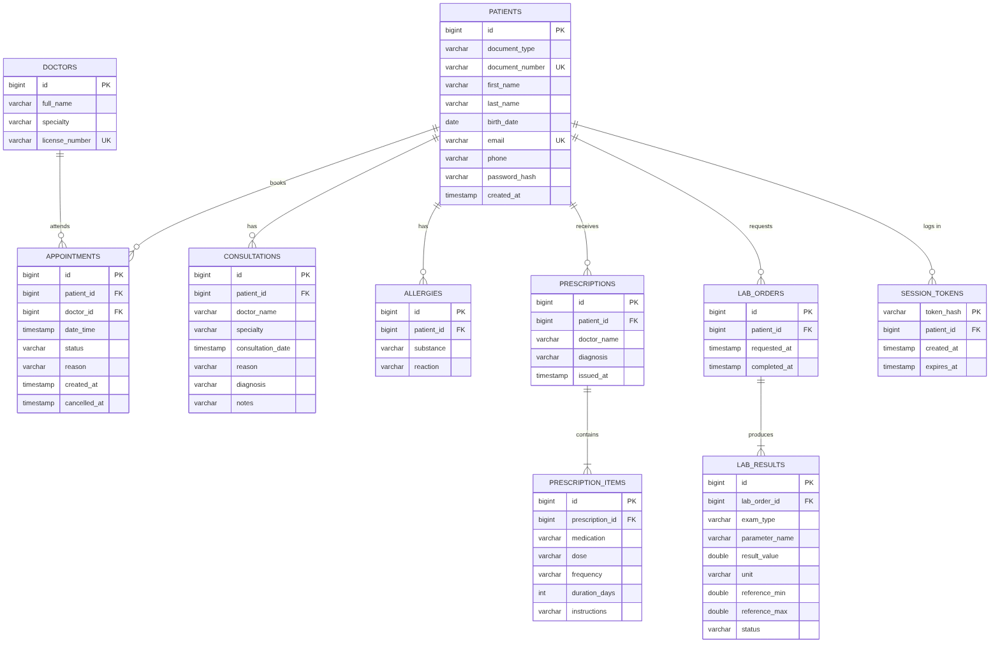

# Sistema de Gestión Médica — Backend

Backend del portal de pacientes de una clínica, construido con **Spring Boot 3.5 (Java 17)** y el **patrón Facade**. El paciente puede registrarse, iniciar sesión, agendar y cancelar citas, ver su historia clínica completa, recibir prescripciones y solicitar exámenes de laboratorio.

El código está en inglés; esta guía está en español para el equipo.

## Patrón Facade

`ClinicFacade` es la única puerta de entrada para el frontend. Los controladores nunca llaman a los subsistemas directamente, y ningún subsistema conoce a los demás: la fachada los coordina.



### Subsistemas

| Requisito | Clase | Responsabilidad |
|---|---|---|
| PacienteService | `PatientService` | Registro, validación de documento único, consulta de perfil, autenticación |
| AgendaService | `ScheduleService` | Disponibilidad por especialidad (4 especialidades, 5 médicos), agendar y cancelar citas, recordatorios |
| HistoriaClinicaService | `MedicalHistoryService` | Consultas previas, diagnósticos y alergias |
| PrescripcionService | `PrescriptionService` | Prescripciones con medicamento, dosis, frecuencia y duración; validación cruzada de alergias |
| LaboratorioService | `LabService` | Exámenes (hemograma, glicemia, perfil lipídico) con resultados simulados y valores de referencia |

### Métodos de la fachada

| Requisito | Método | Subsistemas que invoca |
|---|---|---|
| `agendarCita(pacienteId, especialidad, fecha)` | `scheduleAppointment(patientId, specialty, dateTime)` | Patient + Schedule + MedicalHistory (recordatorio de alergias) |
| `verHistoriaCompleta(pacienteId)` | `getFullHistory(patientId)` | Los 5: citas, consultas, prescripciones y laboratorios en un solo objeto |
| `generarPrescripcion(pacienteId, medicamentos[])` | `generatePrescription(patientId, medications)` | Patient + MedicalHistory (alergias) + Prescription (+ Schedule si se indica el médico) |
| `solicitarExamenes(pacienteId, examenes[])` | `requestExams(patientId, exams)` | Patient + Lab |

También tiene `registerPatient`, `getPatientProfile` y `cancelAppointment`, que usan 2 subsistemas cada uno.

La validación de alergias reconoce familias de medicamentos en inglés y español: una alergia a la penicilina bloquea la amoxicilina, y una alergia al ibuprofeno bloquea el naproxeno. Si hay conflicto, responde **409** con el detalle de cada medicamento rechazado.

## Endpoints REST

Por indicación del equipo, las rutas del enunciado se tradujeron al inglés:

| Enunciado | Endpoint | Acceso |
|---|---|---|
| `POST /api/clinica/paciente` | `POST /api/clinic/patient` | Público |
| `POST /api/clinica/cita` | `POST /api/clinic/appointment` | Token |
| `GET /api/clinica/historia/{pacienteId}` | `GET /api/clinic/history/{patientId}` | Token |
| `POST /api/clinica/prescripcion` | `POST /api/clinic/prescription` | Token |
| `POST /api/clinica/laboratorio` | `POST /api/clinic/lab` | Token |
| `GET /api/clinica/medicos?especialidad=` | `GET /api/clinic/doctors?specialty=&date=` | Público |

Endpoints adicionales que necesita el frontend:

| Endpoint | Para qué | Acceso |
|---|---|---|
| `POST /api/clinic/auth/login` | Inicio de sesión, devuelve el token | Público |
| `POST /api/clinic/auth/logout` | Cierra la sesión | Token |
| `GET /api/clinic/patient/{patientId}` | Perfil del paciente | Token |
| `DELETE /api/clinic/appointment/{appointmentId}` | Cancelar una cita | Token |
| `GET /api/clinic/specialties` | Lista de especialidades | Público |
| `GET /api/clinic/lab/exams` | Catálogo de exámenes con rangos de referencia | Público |
| `GET /api/health` | Verificación para el despliegue | Público |

La documentación interactiva está en **http://localhost:8080/swagger-ui.html**. El archivo `docs/api-requests.http` trae ejemplos de todas las peticiones.

## Requisitos

- JDK 17 o superior
- Maven 3.9 o superior (IntelliJ IDEA ya lo trae incluido)

## Ejecutar

Desde la carpeta del proyecto (donde está `pom.xml`):

```bash
mvn spring-boot:run
```

El backend queda en **http://localhost:8080**. Para correr las pruebas:

```bash
mvn test
```

Si prefieren no instalar Maven, pueden generar el Maven Wrapper una vez con `mvn -N wrapper:wrapper` y desde entonces usar `./mvnw` (o `mvnw.cmd` en Windows).

## Datos iniciales

- **5 médicos predefinidos** en 4 especialidades (Medicina General, Cardiología, Dermatología, Pediatría). Se cargan siempre que la tabla de médicos esté vacía.
- **Paciente de demostración**, con citas pasadas y futuras, consultas, una prescripción, resultados de laboratorio y alergia a la penicilina:
  - Documento: `1000000001`
  - Contraseña: `Demo1234!`

Para no cargar el paciente de demostración: `SEED_DEMO_DATA=false`.

## Base de datos (PostgreSQL en Neon)

Por defecto usa **H2 en memoria**, como pide el enunciado ("datos completamente en memoria"). Con variables de entorno el mismo código se conecta a **PostgreSQL en Neon**, sin cambiar nada en Java.



Scripts en `database/`:

| Archivo | Uso |
|---|---|
| `schema.sql` | Crea las 10 tablas, llaves foráneas e índices |
| `seed.sql` | Inserta los 5 médicos predefinidos (4 especialidades) |
| `drop.sql` | Borra todas las tablas para empezar de cero |

Pasos en Neon:

1. Crear el proyecto en Neon y copiar la cadena de conexión (endpoint directo, sin `-pooler`).
2. En el SQL Editor de Neon ejecutar `database/schema.sql` y luego `database/seed.sql`.
3. Configurar en el backend (Railway) estas variables:

| Variable | Ejemplo |
|---|---|
| `DB_URL` | `jdbc:postgresql://ep-xxxx.us-east-2.aws.neon.tech/neondb?sslmode=require` |
| `DB_USERNAME` | `neondb_owner` |
| `DB_PASSWORD` | `****` |
| `DB_DDL_AUTO` | `validate` (tablas creadas con el script) o `update` (Hibernate las crea) |
| `DB_POOL_SIZE` | `5` |

El paciente de demostración (documento `1000000001`, contraseña `Demo1234!`) lo crea el backend al iniciar, porque la contraseña se guarda con BCrypt.

Las variables pueden ir en un archivo `.env` en la raíz del proyecto: el backend lo lee automáticamente. Usen `.env.example` como plantilla. En producción se configuran en el panel del proveedor.

## Guía para el frontend

1. **Registro:** `POST /api/clinic/patient`. Los códigos de documento son `CITIZEN_ID`, `IDENTITY_CARD`, `FOREIGNER_ID` o `PASSPORT`.
2. **Login:** `POST /api/clinic/auth/login` con `documentNumber` y `password`. Devuelve `token`, `expiresAt` y los datos del paciente.
3. **Peticiones protegidas:** enviar el encabezado `Authorization: Bearer <token>`. Cada paciente solo puede ver sus propios datos: si pide los de otro, responde **403**.
4. **Agendar cita:** primero `GET /api/clinic/doctors?specialty=CARDIOLOGY&date=2026-10-27`, que devuelve cada médico con su lista `availableSlots` (`"08:00"`, `"08:30"`…). Luego `POST /api/clinic/appointment` con `patientId`, `specialty`, `dateTime` (`2026-10-27T10:00:00`) y, opcionalmente, `doctorId` y `reason`. Si no se envía médico, se asigna el primero libre.
5. **Dashboard e historia clínica:** `GET /api/clinic/history/{patientId}` devuelve todo en un objeto: `upcomingAppointments`, `pastAppointments`, `consultations`, `prescriptions`, `labOrders`, `allergies` y un `summary`.
6. **Laboratorio:** cada parámetro trae `value`, `referenceMin`, `referenceMax`, `status` (`LOW`, `NORMAL`, `HIGH`) y `withinRange` (true/false) para pintar el indicador de rango.

Horario de citas: lunes a viernes, cada 30 minutos de 08:00 a 11:30 y de 14:00 a 16:30, hasta 90 días adelante.

Todos los errores tienen el mismo formato:

```json
{ "status": 409, "error": "Conflict", "message": "...", "path": "/api/clinic/prescription", "details": ["..."] }
```

Los errores de validación incluyen `fieldErrors` con el mensaje de cada campo.

**CORS:** la variable `FRONTEND_URL` lista los orígenes permitidos, separados por comas. Acepta comodines como `https://*.vercel.app`.

## Despliegue (PROD)

El `Dockerfile` construye y ejecuta el backend, y sirve en Render, Railway o Fly.io. Variables mínimas en producción:

- `FRONTEND_URL`: URL del frontend desplegado
- `DB_URL`, `DB_USERNAME`, `DB_PASSWORD` y `DB_DDL_AUTO`, si usan una base de datos real

El puerto se toma de la variable `PORT` que inyecta el proveedor. Con H2 en memoria los datos se reinician cada vez que el servidor se reinicia.

## Estructura

```
src/main/java/com/clinic/
  facade/       ClinicFacade (patrón Facade)
  service/      los 5 subsistemas, autenticación y simulador de laboratorio
  controller/   endpoints REST
  model/        entidades JPA y enums
  repository/   repositorios Spring Data JPA
  dto/          objetos de entrada (request) y salida (response)
  security/     validación del token y control de acceso
  exception/    errores de negocio y manejador global
  config/       configuración, CORS, Swagger y datos iniciales
database/
  schema.sql            tablas de PostgreSQL
  seed.sql              médicos predefinidos
  drop.sql              limpieza de tablas
docs/
  er-diagram.png        diagrama entidad relación
  er-diagram.mmd        diagrama en Mermaid
  api-requests.http     ejemplos de peticiones
```
